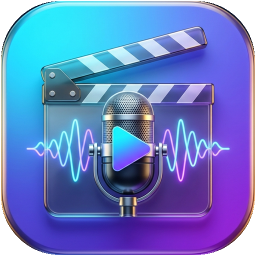

<p align="center">
  
</p>

# AI Movie Translator & Auto Dubbing Studio
### កម្មវិធីបកប្រែខ្សែភាពយន្ត និងបញ្ចូលសំឡេងស្វ័យប្រវត្តិតាម AI

[](https://www.python.org/)
[](https://www.qt.io/)
[](https://github.com/SYSTRAN/faster-whisper)
[](https://github.com/rany2/edge-tts)

---

## 🚀 របៀបដំណើរការកម្មវិធី (Quick Start)

### វិធីទី ១៖ ដំណើរការដោយផ្ទាល់តាមរយៈ Run Script (Windows)
ចុចពីរដង (Double-click) លើឯកសារ៖
```cmd
run.bat
```

### វិធីទី ២៖ ដំណើរការតាម Command Line
```bash
python main.py
```

### ដំណើរការតេស្តស្វ័យប្រវត្តិ (Run Unit Tests)
```bash
python -m unittest discover tests -v
```

---

## ✨ អ្វីដែលថ្មីនៅក្នុង v1.4.0

### 1. 📦 Batch Mode (ដំណើរការវីដេអូទាំង Folder ដោយស្វ័យប្រវត្តិ)
- ចុចប៊ូតុង **📦 Batch** នៅលើ Toolbar ខាងលើ ឬ **File → 📦 Batch (Ctrl+Shift+B)**។
- ជ្រើសរើស **Folder វីដេអូដើម** (អាចស្កេន Subfolders) និង **Folder លទ្ធផល** ជាមួយការតម្រៀបតាមលេខភាគធម្មជាតិ (`EP1, EP2, EP10`)។
- កំណត់ជំហានដំណើរការ៖ ស្រង់អត្ថបទ → បកប្រែ → Export SRT (`.km.srt` & `.zh.srt`) → AI Dub + Render MP4។
- **រក្សាទុកស្ថានភាពលើ Disk (`batch_queue.json`)**៖ អាច Pause / Resume / Cancel / Retry Failed និងបន្តឡើងវិញបន្ទាប់ពីបិទកម្មវិធី។
- ប្រើប្រាស់ **Shared Glossary** រួមគ្នាគ្រប់ភាគ ដើម្បីឱ្យឈ្មោះតួអង្គដូចគ្នាទូទាំងរឿង។

### 2. 💬 OpenAI / ChatGPT Integration (Speech-to-Text + Batch SRT Translation)
- ចូលទៅ **Settings → 💬 OpenAI / ChatGPT** ដើម្បីបញ្ចូល **OpenAI API Key** (រក្សាទុកដោយសុវត្ថិភាពក្នុង Windows Credential Manager / DPAPI មិនរក្សាទុកជាអក្សរសាមញ្ញក្នុង JSON ឡើយ)។
- ចុច **🔗 សាកល្បងការតភ្ជាប់ & ទាញម៉ូដែល** ដើម្បីផ្ទៀងផ្ទាត់ Key និងទាញបញ្ជីម៉ូដែលពី OpenAI API (គាំទ្រ Custom Base URL / Proxy)។
- **Transcribe (OpenAI Audio API)**៖ បំបែកសំឡេងឆ្លាតវៃតាមចន្លោះស្ងាត់ (`< 24 MB` ក្នុងមួយកំណាត់) និងបូក Offset ពេលវេលាត្រឹមត្រូវ។
- **Batch SRT Translation**៖ បកប្រែ 20–40 ជួរក្នុងមួយ Batch ជា Structured JSON ជាមួយការផ្ទៀងផ្ទាត់ Index ការ Retry តែជួរដែលខ្វះ ការប៉ាន់ស្មាន Token/តម្លៃ USD និង Google Fallback។

---

## 🌟 លក្ខណៈពិសេសចម្បង (Key Features)

1. **🎬 នាំចូលវីដេអូគ្រប់ទម្រង់ (Video Import):**
   - គាំទ្រឯកសារ `MP4`, `MKV`, `AVI`, `MOV`។
2. **🎙️ ស្ដាប់សំឡេងបំប្លែងជាអក្សរស្វ័យប្រវត្តិ (Speech-to-Text):**
   - ប្រើប្រាស់ `faster-whisper` កំណត់សម្គាល់ភាសាស្វ័យប្រវត្តិ និងស្រង់ម៉ោងគិតជាវិនាទីយ៉ាងជាក់លាក់។
3. **🌐 បកប្រែជាភាសាខ្មែរសន្ទនាភាពយន្ត (Movie Dubbing Translation):**
   - គាំទ្រ Google Gemini API, Anthropic Claude, OpenAI, និង Web Translation។
   - គាំទ្រវចនានុក្រមឈ្មោះតួអង្គ (Character Glossary) ដូចជា *Tony Stark -> ថូនី ស្តាក*។
4. **🗣️ សំឡេង AI ខ្មែរធម្មជាតិ (Khmer Neural TTS):**
   - ប្រើប្រាស់សំឡេង Microsoft Edge Neural Khmer Voices (`km-KH-PisethNeural` សំឡេងប្រុស និង `km-KH-SreymomNeural` សំឡេងស្រី)។
5. **⏱️ ម៉ាស៊ីនតម្រឹមពេលវេលា ៤ ដំណាក់កាល (4-Stage Time-Sync Engine):**
   - **ដំណាក់កាលទី ១៖** បង្កើនល្បឿន TTS (អតិបរមា ~1.25x)។
   - **ដំណាក់កាលទី ២៖** សង្ខេបអត្ថបទខ្មែរតាមរយៈ AI ឱ្យខ្លីល្មមនិយាយទាន់។
   - **ដំណាក់កាលទី ៣៖** ខ្ចីចន្លោះពេលទំនេរ (Empty gap) ពីវគ្គបន្ទាប់។
   - **ដំណាក់កាលទី ៤៖** បង្រួមពេលវេលាតាមរយៈ FFmpeg `atempo` (មិនលើស 1.30x)។
   - **វិធានការពារ៖** មិនឱ្យសំឡេងត្រួតស៊ីគ្នា (Anti-overlap enforcement) និងមានរបាយការណ៍ Sync Report បង្ហាញវគ្គដែលលើសកម្រិត (`OVERFLOW`)។
6. **👥 ការកំណត់សំឡេងតាមតួអង្គ (Speaker Diarization Support):**
   - បែងចែកតួអង្គ (Speaker 1, Speaker 2...) និងកំណត់សំឡេងប្រុស/ស្រីផ្សេងគ្នា។
7. **🎚️ ការលាយសំឡេង និង Ducking (Audio Mixing & Ducking):**
   - បន្ទាបសំឡេងដើម/ភ្លេងផ្ទៃខាងក្រោយចុះដោយស្វ័យប្រវត្តិនៅពេលមានសំឡេង AI ខ្មែរនិយាយ និងដំឡើងមកវិញដោយរលូន (Smooth Fade-in/Fade-out)។
8. **📦 ការនាំចេញវីដេអូ និងអក្សររត់ (Export):**
   - នាំចេញជាវីដេអូ `MP4` ដែលមានសំឡេងបញ្ចូលរួច។
   - នាំចេញឯកសារអក្សររត់ក្រោម `SRT` (ភាសាខ្មែរ ឬទ្វេភាសា)។
   - នាំចេញឯកសារសំឡេង `WAV`។
   - ជម្រើសដុតអក្សររត់ក្រោមជាប់លើវីដេអូ (Burn-in Subtitles) ដោយប្រើពុម្ពអក្សរ **Kantumruy Pro**។
9. **🔄 ជួរដំណើរការវីដេអូច្រើន (Batch Queue):**
   - ដាក់វីដេអូច្រើនក្នុងជួរដើម្បីដំណើរការបន្តបន្ទាប់គ្នាដោយស្វ័យប្រវត្តិ។
10. **🌓 រចនាបថ Dark Theme និងទ្វេភាសា (Khmer / English):**
    - អាចចុចប៊ូតុងប្តូររវាងភាសាខ្មែរ និងអង់គ្លេសបានគ្រប់ពេល។
    - ប្រព័ន្ធរក្សាទុកស្វ័យប្រវត្តិ (Auto-save) រៀងរាល់ 30 វិនាទី និងសួររកការស្តារគម្រោងចាស់ឡើងវិញ (Resume session)។
11. **🔄 ប្រព័ន្ធ Version និង Auto-Update ស្វ័យប្រវត្តិតាមអនឡាញ (Auto-Updater):**
    - គាំទ្រការពិនិត្យមើលកំណែថ្មី និងទាញយក Update ដោយផ្ទាល់ពីក្នុងកម្មវិធី។
    - ពេលក្លាយជាឯកសារ `.exe` នៅលើកុំព្យូទ័រផ្សេង ប្រព័ន្ធនឹងទាញយកកំណែថ្មី និងជំនួស `.exe` ចាស់ដោយស្វ័យប្រវត្តិ (In-place self replacement & restart)។

---

## 📦 របៀបបង្កើតឯកសារ .EXE និងបញ្ចេញកំណែ Update (Packaging & Updating)

### ជំហានទី ១៖ បង្កើតឯកសារ `.exe` សម្រាប់ចែករំលែកលើ PC ផ្សេង
ដំឡើង PyInstaller ប្រសិនបើមិនទាន់មាន៖
```bash
pip install pyinstaller
```
ដំណើរការ script បង្កើត `.exe` ស្វ័យប្រវត្តិ៖
```bash
python build_exe.py
```
ឯកសារ `.exe` ដែលមានបង្កប់ព័ត៌មាន Version (File properties) នឹងត្រូវបានបង្កើតនៅក្នុងថត៖
`dist/AI_Movie_Dubbing_Studio/AI_Movie_Dubbing_Studio.exe`

### ជំហានទី ២៖ របៀបបញ្ចេញកំណែ Update ទៅកាន់ PC ផ្សេងទៀត
1. នៅពេលអ្នកកែសម្រួល Code ឬបន្ថែមមុខងារថ្មី សូមដំឡើងលេខ Version ក្នុង [app/config.py](file:///d:/summray_mo/app/config.py) (ឧទាហរណ៍៖ `APP_VERSION = "1.1.0"`)។
2. បង្កើតឯកសារ `.exe` ថ្មីតាមរយៈ `python build_exe.py`។
3. ដាក់បង្ហោះឯកសារ `.exe` ថ្មីនោះលើ **GitHub Releases** ឬ Server ផ្ទាល់ខ្លួន។
4. កែសម្រួលឯកសារ [version.json](file:///d:/summray_mo/version.json) ដោយដាក់លេខកំណែថ្មី និង Link ទាញយក៖
   ```json
   {
     "version": "1.1.0",
     "release_date": "2026-11-15",
     "download_url": "https://github.com/username/repo/releases/download/v1.1.0/AI_Movie_Dubbing_Studio.exe",
     "changelog_km": "- កែលម្អល្បឿនសំឡេង AI\n- ជួសជុលបញ្ហា sync"
   }
   ```
5. នៅពេលអ្នកប្រើប្រាស់នៅលើ PC ផ្សេងបើកកម្មវិធី ឬចុច **«Help -> 🔄 ពិនិត្យមើលកំណែថ្មី»** កម្មវិធីនឹងប្រាប់ថាមានកំណែថ្មី ហើយអាចចុច **«⚡ Update ឥឡូវនេះ»** ដើម្បីទាញយក និងប្តូរទៅកាន់ `.exe` ថ្មីដោយស្វ័យប្រវត្តិភ្លាមៗ!

---

## 📁 រចនាសម្ព័ន្ធគម្រោង (Project Structure)

```
d:/summray_mo/
├── app/
│   ├── config.py              # Configuration, App Version & Bilingual strings
│   ├── updater.py             # In-place auto-update engine for Windows .exe
│   ├── models.py              # Segment, Project, Speaker, Settings models
│   ├── database.py            # SQLite database & JSON project persistence (.aidub)
│   ├── audio_engine.py        # FFmpeg extraction, mixing, ducking, time-stretch
│   ├── stt_engine.py          # faster-whisper STT integration
│   ├── translation_engine.py  # Translation (Gemini, Claude, OpenAI, Google) & Shortening
│   ├── tts_engine.py          # Edge-TTS Khmer voices (Piseth & Sreymom)
│   ├── sync_engine.py         # 4-Stage Cascade Time-sync rules & Sync Report
│   ├── export_engine.py       # MP4 muxing, SRT subtitle generator, burn-in subtitles
│   ├── utils.py               # Timecode formatting, SRT parser
│   └── ui/
│       ├── styles.py          # Dark theme stylesheet & Kantumruy Pro styling
│       ├── video_player.py    # Video player widget with segment preview
│       ├── segment_table.py   # Subtitle & Dubbing editor table with sync badges
│       ├── update_dialog.py   # Software Update Dialog (changelog, download & restart)
│       ├── speaker_manager.py # Character speaker & voice assignment dialog
│       ├── sync_report_dialog.py # Time-sync report dialog with metrics & jump
│       ├── settings_dialog.py # API keys, Whisper model, ducking, auto-update config
│       ├── batch_dialog.py    # Multi-movie batch processing queue
│       └── main_window.py     # Main application window
├── tests/
│   └── test_core.py           # Comprehensive unit & integration tests
├── requirements.txt           # Python dependencies
├── run.bat                    # One-click Windows starter batch script
├── main.py                    # Application entry point
├── build_exe.py               # Standalone Windows .exe packager
├── version_info.txt           # Windows PE executable version resource definition
├── version.json               # Remote update manifest template
├── SRS_KHMER.md               # Complete Software Requirements Specification in Khmer
└── README.md                  # Project documentation
```

---

## 📜 ឯកសារបញ្ជាក់តម្រូវការ (SRS)
សូមមើលឯកសារលម្អិត [SRS_KHMER.md](file:///d:/summray_mo/SRS_KHMER.md) សម្រាប់លក្ខខណ្ឌតម្រូវការបច្ចេកទេសពេញលេញជាភាសាខ្មែរ។
